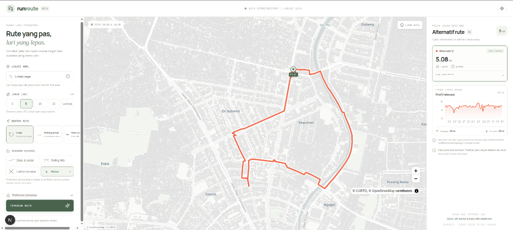

# RunRoute

RunRoute is a map-first running route discovery MVP. The interface is in Bahasa Indonesia. It uses real pedestrian route geometry from openrouteservice (OpenStreetMap data) and never fabricates a route when a provider is unavailable.



## Architecture

- Next.js App Router, TypeScript, React.
- MapLibre GL JS with the CARTO Positron hosted vector style and visible OpenStreetMap/CARTO attribution.
- Server-side openrouteservice requests for walking routes and geocoding. The API key is never sent to the browser.
- Nominatim is deliberately not used: its public service policy restricts generic geocoding integration in generated applications.
- Route distance is recalculated from returned geometry. Loop candidates use ORS round-trip requests with different seeds and length targets; results outside the configured distance tolerance and duplicate geometries are discarded. Out-and-back and point-to-point are built from actual provider routes.
- When ORS returns elevation samples with route geometry, the app calculates ascent/descent and plots the selected route; absent samples are shown as unavailable, not invented.

## Routing & Core Algorithms

The route generation and evaluation pipeline combines external graph routing with custom spatial and geodesic algorithms:

### 1. Pedestrian Graph Routing (OpenRouteService & OpenStreetMap)
- Uses Contraction Hierarchies (CH) and A* / Dijkstra shortest path variants over pedestrian-tagged OpenStreetMap ways (`foot-walking`).
- **Loop Generation**: Generates round-trip polygons with varying random seeds (`197 + i * 53`) and target lengths to produce diverse circular course candidates returning to the starting point.
- **Out-and-Back Generation**: Routes from the start coordinate to a projected turnaround waypoint, and then returns along the pedestrian network.
- **Point-to-Point**: Direct pedestrian routing between user-selected start and destination coordinates.

### 2. Geodesic Distance (Haversine Formula)
Implemented in [`src/lib/routes.ts`](src/lib/routes.ts), calculating great-circle distance over a spherical earth ($R = 6,371,000\text{ m}$):
$$\Delta\text{lat} = (\text{lat}_2 - \text{lat}_1)\frac{\pi}{180}, \quad \Delta\text{lon} = (\text{lon}_2 - \text{lon}_1)\frac{\pi}{180}$$
$$a = \sin^2\left(\frac{\Delta\text{lat}}{2}\right) + \cos(\text{lat}_1)\cos(\text{lat}_2)\sin^2\left(\frac{\Delta\text{lon}}{2}\right)$$
$$d = 2 R \arcsin(\sqrt{a})$$
- **`geometryDistance`**: Sums consecutive Haversine segments across the polyline to determine exact real distance.
- **Loop Closure Check**: Rejects loop routes whose ending coordinates deviate $> 100\text{ m}$ from the starting point.
- **Distance Tolerance**: Filters candidates with `isWithinTolerance` (e.g. $\pm 5\%$).

### 3. Out-and-Back Waypoint Projection
Computes turnaround waypoints at half the target distance ($\Delta_{\text{meters}} = \frac{\text{target}}{2}$) rotated by radial bearing $\theta = i \times 0.72\text{ rad}$:
$$\Delta_{\text{deg}} = \frac{\Delta_{\text{meters}}}{111,000}$$
$$\text{turnLon} = \text{startLon} + \frac{\cos(\theta) \cdot \Delta_{\text{deg}}}{\cos(\text{startLat} \cdot \frac{\pi}{180})}, \quad \text{turnLat} = \text{startLat} + \sin(\theta) \cdot \Delta_{\text{deg}}$$

### 4. Spatial Polyline Deduplication (`deduplicateRoutes`)
Prevents near-identical alternative routes from cluttering results using a three-tier comparison:
1. **Distance Proximity**: Total distance difference $< 80\text{ m}$.
2. **Origin Proximity**: Starting coordinate distance $< 15\text{ m}$.
3. **Decimated Subsample Matching**: Subsamples ~10 points along the polyline ($\text{step} \approx \max(1, \lfloor N / 10 \rfloor)$) and confirms whether every sampled point lies within $65\text{ m}$ of any coordinate on the comparison candidate. If all match, the duplicate route is discarded.

### 5. Geometry Validation (`validGeometry`)
- Ensures line strings contain $\ge 2$ coordinates.
- Validates coordinates are finite numbers and within physical limits: latitude $\in [-90, 90]$, longitude $\in [-180, 180]$.
- Rejects zero-distance or collapsed polylines.

### 6. Elevation Profiling & Multi-Criteria Ranking
- **Cumulative Totals (`elevationTotals`)**: Performs an $\mathcal{O}(N)$ scan over 3D coordinates $(x, y, z)$ to calculate total ascent and descent, gracefully skipping missing/null elevation samples.
- **Terrain Preference Penalty**:
  - `flat`: Penalizes elevation gain ($\min(30, \text{ascent} / 5)$).
  - `hilly`: Rewards elevation gain ($-\min(30, \text{ascent} / 8)$).
  - `rolling`: Penalizes divergence from an ideal $5\text{ m/km}$ grade.
  - `any`: No elevation penalty ($0$).
- **Composite Score**:
  $$\text{Score} = \max\left(0, 100 - \frac{|\text{actualDistance} - \text{targetDistance}|}{\text{targetDistance}} \times 100 - \text{elevationPenalty}\right)$$
  Candidate routes are sorted descending by score so the closest and best-fitting route ranks first.

## Requirements

- Node.js 20.9 or later and npm.
- An openrouteservice API key for real routes and name search. The provider's free tier is subject to quotas, feature limits, and its current terms. The app can start without a key; the API explains how to enable real route search. A user can still choose a map point as the starting location.

## Local development

```sh
cp .env.example .env.local
# Set OPENROUTESERVICE_API_KEY in .env.local
npm install
npm run dev
```

Open http://localhost:3000. The map style loads from CARTO's hosted basemap service and requires internet access. `NEXT_PUBLIC_MAP_STYLE_URL` can point to another compatible style; maintain its required attribution and usage terms.

### Unified Frontend & Backend (Single Port)

This application is built with the Next.js App Router, which operates as a unified full-stack server. Running `npm run dev` starts **both** the frontend and backend simultaneously on the same port:

- **Frontend (UI)**: Served at the root path (`http://localhost:3000/`) with React, MapLibre GL, Recharts, and Vanilla CSS.
- **Backend (API Handlers)**: Served at the API route paths:
  - `GET http://localhost:3000/api/geocoding/search` — Place name search and geocoding proxy.
  - `POST http://localhost:3000/api/routes/search` — Route generation, elevation analysis, and ranking.

Because both run on the same server, port, and origin:
- **No CORS issues**: Browser requests from the frontend to the backend are same-origin.
- **Clean relative paths**: The client UI fetches endpoints with relative paths (e.g. `fetch('/api/routes/search')`).
- **Single terminal command**: You only need to run `npm run dev` in one terminal; no separate backend server is required.

### Port Configuration

Port `3000` is the default port assigned by Next.js. If port 3000 is occupied or you wish to use a custom port:

1. **Via CLI flag**:
   ```sh
   npm run dev -- -p 4000
   ```
2. **Via environment variable**:
   ```sh
   PORT=4000 npm run dev
   # or define PORT=4000 in .env.local
   ```
3. **In `package.json`**:
   Update the script command to `"dev": "next dev -p 4000"`.

## Commands

```sh
npm run dev       # development server
npm run typecheck # TypeScript validation
npm run lint      # ESLint
npm test          # deterministic geometry unit tests
npm run build     # production build
npm start         # serve the production build
```

GitHub Actions runs lint, type checks, unit tests, and a production build on pushes and pull requests targeting `main`. To make the key available during the workflow build, create the `OPENROUTESERVICE_API_KEY` repository secret in **Settings → Secrets and variables → Actions**. This CI workflow does not deploy the app; configure the same variable in the eventual hosting provider for runtime routing and geocoding.

A separate **Deploy GitHub Pages** workflow publishes a static preview at `https://luqmanulhakimdev.github.io/running-route-finder/` after pushes to `main`. In repository settings, set **Pages → Build and deployment → Source** to **GitHub Actions** if it is not already selected. The Pages preview supports the map, device location, and manual point selection. It does not run route search or geocoding because GitHub Pages cannot host the app’s dynamic API handlers; no ORS key is exposed in the static bundle. Use a Next.js-capable server deployment for the complete route-discovery workflow.

## Environment

- `OPENROUTESERVICE_API_KEY` — required for live route generation and geocoding; server-only.
- `NEXT_PUBLIC_MAP_STYLE_URL` — optional MapLibre style URL. Defaults to CARTO Positron.

## Providers, licensing, and limits

- Routes and geocoding: openrouteservice. Create a key with the provider and review current free quota, request limits, and terms before use. A missing key, timeout, quota error, or unreachable provider is surfaced in the interface.
- Underlying route data: OpenStreetMap, © OpenStreetMap contributors, ODbL. Completeness and pedestrian access tags vary by place; verify local conditions.
- Map tiles/style: hosted CARTO basemap with © CARTO and © OpenStreetMap attribution displayed on-map. CARTO's hosted basemap terms can change; confirm suitability for deployment and expected traffic. The hosted map service is not an unlimited production tile service.
- Geocoding: ORS geocoding via the same server-side key. Requests are debounced by the client and response caching is enabled.
- Elevation samples are requested with ORS route geometry and used for ascent/descent, profile display, and a basic elevation-preference ranking when the provider returns them. Missing values stay unknown; terrain preference becomes less reliable without those samples. Safety/accessibility/green-space claims and ranking are not implemented.
- Local/demo mode does not return fake route geometry. Without an ORS key, live route search is unavailable.

## Current limitations

- The ORS round-trip engine may not find enough distinct loops in every location or within the requested distance tolerance. It searches a small bounded set of alternatives and reports when it cannot.
- Out-and-back selection uses a generated turning coordinate and then validates the provider's actual returned distance. Point-to-point lets the user mark an endpoint on the map.
- Elevation depends on ORS returning elevation in route geometry; if unavailable, profile and totals remain blank and terrain ranking is limited.
- Road surface, green-space, lighting, sidewalk, and traffic ranking are not claimed by this MVP.

## Safety

Route recommendations do not guarantee safety or current access. Check signs, access restrictions, weather, and current conditions, and follow local traffic laws. OpenStreetMap content may be incomplete or outdated.
